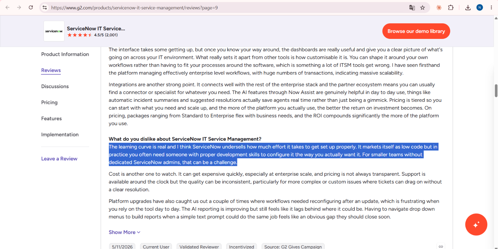

# SentinelOps — Enterprise IT Service Management (ITSM) Platform


[](https://github.com/nisakrkmz/sentinel_ops/actions/workflows/ci.yml)


> **Canlı Uygulama URL:** [https://sentinel-ops-k0km.onrender.com](https://sentinel-ops-k0km.onrender.com) — Render deploy'u `23aa422` commit'inde başarılı; 17 Ekim 2026'da HTTP 200 ile kontrol edildi.
>
> **GitHub Deposu:** [https://github.com/nisakrkmz/sentinel_ops](https://github.com/nisakrkmz/sentinel_ops)
>
> **İlham Kaynağı:** Bu proje, kurumsal BT dünyasının sektör standardı olan **ServiceNow (IT Service Management - Incident Management)** ürününün mimarisinden ve ITIL v4 operasyon standartlarından ilham alınarak geliştirilmiştir. Orijinal marka adı veya logosu uygulamada yer almaz.

---

## 📊 Faz 1: Fortune 500 SaaS Ekosistemi Araştırması

Fortune'un 2026 listesi şirketleri **gelire** göre sıralar; değerleme ve SaaS tüketimi Fortune tarafından tek bir standart aralık olarak yayımlanmaz. Aşağıdaki değerler farklı kaynakların yaklaşık kurumsal göstergeleridir; Fortune 500'ün tamamını kapsayan denetlenmiş bir veri seti değildir.

| Metrik | Değer / Aralık | Doğrulanmış Kaynak |
| :--- | :--- | :--- |
| **a. Değerleme (piyasa değeri)** | Halka açık büyük şirketlerde yaklaşık **$1 milyar mertebesinden birkaç trilyon dolara**; şirket ve tarih seçimine göre değişir. Fortune listesi piyasa değerine göre sıralanmadığı ve özel şirketleri de içerdiği için bu, Fortune 500 için kesin minimum-maksimum değildir. | [Fortune 500 sıralama yöntemi](https://fortune.com/ranking/fortune500/) (gelir) · [CompaniesMarketCap şirket değerleri](https://companiesmarketcap.com/) (günlük değişen piyasa değeri) |
| **b. Çalışan sayısı** | Yaklaşık **1.000'lerden 2,1 milyona**. Düşük uç, şirket bildirimlerinden türetilmiş yaklaşık büyüklüktür; Walmart üst uç örneğidir. | [Fortune 500](https://fortune.com/ranking/fortune500/) · [Statista: Fortune 500'de en büyük işverenler](https://www.statista.com/statistics/264423/number-of-employees-at-the-largest-us-companies/) |
| **c. Firma başına SaaS sayısı** | [Zylo 2026 SaaS Management Index](https://zylo.com/2026-saas-management-index) örnekleminde ortalama **305 uygulama**. Bu Fortune 500'e özel sayım değil, kurumsal SaaS portföyü benchmark'ıdır. | [Zylo 2026 SaaS Management Index](https://zylo.com/2026-saas-management-index) |
| **d. Yıllık SaaS harcaması** | Aynı Zylo benchmark'ında kuruluş başına ortalama **$55,7 milyon/yıl**. Örneklem ortalaması; her Fortune 500 şirketi için geçerli veya denetlenmiş bir tutar değil. | [Zylo 2026 SaaS Management Index](https://zylo.com/2026-saas-management-index) |

---

## 🏢 SaaS Seçimi & Fortune 500 Kanıtı

- **Seçilen Ürün:** **ServiceNow (ITSM - Incident Management)**
- **Fortune 500 kanıtı:** [Walmart](https://fortune.com/ranking/fortune500/) Fortune 500 şirketidir ve [ServiceNow'un Walmart müşteri hikâyesinde](https://www.servicenow.com/customers/walmart.html) müşteri olarak yer alır. Bu, en az bir Fortune 500 şirketinin ürünü kullandığına kanıttır; **%85** iddiası için doğrulanabilir kaynak bulunmadığından çıkarılmıştır.
- **Ölçek:** ServiceNow kaynak kodu yayımlanmadığı için gerçek LOC sayısı bilinmiyor. Aşağıdaki **~300.000 LOC** yalnızca kendi kaba tahminimdir; ölçülmüş veya vendor tarafından doğrulanmış bir sayı değildir.

---

## 💰 Faz 2: Maliyet & Geliştirme Tahmini

### 1. Satır Sayısı Tahmini ve Metodoloji
- **Tahmini satır sayısı:** ~300.000 LOC (düşük güvenli, kaba merkez tahmini).
- **Tahmin yöntemi:** Özel kaynak kodu erişilebilir olmadığından modül bazlı kaba büyüklük tahmini yaptım: olay/durum motoru (~50k), SLA/iş kuralları (~45k), CMDB/varlıklar (~55k), kullanıcı/roller/portallar (~45k), entegrasyonlar/raporlama (~45k), arayüz/otomasyon/yönetim (~60k); toplam ~300k LOC. Bu, dosya sayımı veya yayımlanmış vendor verisi değildir; kesinlik iddiası taşımaz. FPA/COCOMO ölçümü yaptığım iddiası kaldırıldı.

### 2. Coding Agent ile Üretim: Tahmin vs. Gerçek

| Parametre | Ön tahmin | Gerçekleşen |
| :--- | :--- | :--- |
| **Geliştirme süresi** | 2-3 gün | AI kullanıldığı doğrulandı; yaklaşık 3 gün. |
| **Token / abonelik maliyeti** | Yaklaşık 15 milyon token ve model fiyatına göre $45-75 API maliyeti (kendi tahminim; abonelik sabit ücreti hariç) | Bu depoda kullanım/billing dökümü yok; 3,4 milyon token ve $14,50 iddiası doğrulanamadığı için gerçekleşen değer olarak sunulmuyor. Gerçek tutar bilinmiyor. |
| **Ajan / model** | Model bağımsız | Antigravity ile Gemini 3.8 Flash ve GitHub Copilot kullanıldı. Copilot model/sürüm bilgisi kaydedilmedi. |

---

## 🫀 Aort Dilimi: Uçtan Uca Olay Akışı

SentinelOps canlıda **ITSM Olay Yönetimi (Incident Management)** akışını uygular. Render'daki `23aa422` deploy'u başarılıdır ve uygulama URL'si HTTP 200 ile doğrulanmıştır.

### 1. Durum Akışı (State Workflow)

```text
New (Yeni)
   │  start_progress!
   ▼
In Progress (İşlemde)
   │  put_on_hold!
   ▼
On Hold (Beklemede)
   │  resolve!
   ▼
Resolved (Çözüldü)
```

### 2. Zaman Kuralı & Dinamik SLA Motoru

- **P1 - Critical:** 15 Dakika Hedef SLA
- **P2 - High:** 2 Saat Hedef SLA
- **P3 - Moderate:** 4 Saat Hedef SLA
- **P4 - Low:** 24 Saat Hedef SLA
- SLA, liste/detay sayfası veya aksiyon isteği geldiğinde kontrol edilir; ayrı bir arka plan zamanlayıcısı yoktur. Süre geçtiyse `sla_status` ihlal olarak işaretlenir, olayın iş akışı durumu ayrıca değişmez ve zaman çizelgesine kayıt eklenir.

### 3. Minitest + `travel_to` Testleri

22 test senaryosu Ubuntu/WSL ortamında 19 Ekim 2026 tarihinde çalıştırıldı: **22 runs, 111 assertions, 0 failures, 0 errors, 0 skips**. Ayrıca GitHub Actions CI, `b831627` commit'inde başarılı tamamlandı.

## Agent-first temeli — Faz 1

Web arayüzü veritabanına bağlı operatör hesapları kullanır: `/signup` ile kayıt, `/login` ile e-posta + şifre girişi. Şifreler `users.password_digest` içinde tuzlu PBKDF2-HMAC-SHA256 (210.000 iterasyon) olarak saklanır; giriş denemeleri IP başına 10/dk ile sınırlıdır. Her kullanıcı bir `human` actor'a bağlıdır, UI'daki kayıt ve onaylar denetim izinde o kullanıcının actor'ına yazılır. Herkese açık demo instance için seed bir demo hesabı (`config/demo_operator.yml`) oluşturur ve giriş ekranında gösterir; `DEMO_OPERATOR_ENABLED=false` ile kapatılır. Eski `NISA_PASSWORD` mekanizması kaldırıldı. REST API ve MCP kendi scope'lu bearer token kimlik doğrulamasını kullanmaya devam eder.

`ApiToken` ham bearer token'ı saklamaz; HMAC-SHA256 digest tutar, scope'ları sınırlar, kullanım zamanını izler ve iptal/süre sonu denetimi yapar. Token issue/auth çağrılarında `AGENT_TOKEN_PEPPER` sunucu ortamında tanımlı olmalıdır. Şu an bu token modellerini kullanan REST endpoint'i henüz yoktur. `Decision` ve `Handoff` tabloları audit/provenance ve insana devir kayıtları için eklenmiştir; henüz AI sağlayıcısı veya workflow bu kayıtları otomatik oluşturmuyor.

`render.yaml` şu anda `AGENT_TOKEN_PEPPER`'ı tanımlamıyor. Token işlemleri herhangi bir deployed API'de etkinleştirilmeden önce Render server environment'a güçlü bir pepper eklenmelidir.

## Typed incident triage — Faz 2

- `DECISION_PROVIDER=groq|nvidia|huggingface|gemini` ile OpenAI-compatible JSON Schema triage adapter'ı seçilir. Sunucu ortamında `DECISION_API_KEY`, `DECISION_MODEL` ve tam HTTPS `DECISION_BASE_URL` verilmelidir. İstek toplam 8 saniyeyi aşmayacak şekilde sınırlandırılır ve en fazla bir retry yapılır.
- `DECISION_PROVIDER=jev` TypeSafe Jev'in resmî `POST https://api.typesafe.ai/v1/systemone` sözleşmesini kullanır (docs.typesafe.ai/api, 2026-10-25). Triage şemasının her alanı tipli bir `choice`/`noul` sorusudur; Jev metin üretmediği için `rationale` Jev'in olasılıklarından derlenir. Duplicate tespiti için son 10 açık incident aday olarak verilir. ENV: `JEV_API_KEY` (zorunlu), `JEV_MODEL` (varsayılan `jev-latest`), `JEV_BASE_URL` (varsayılan resmî endpoint). Anahtar yoksa karar `jev_not_configured` ile dürüstçe beklemede kalır. Not: bu repoda Jev ile canlı çağrı henüz yapılmadı (anahtar yok); sözleşme birim testleriyle doğrulandı.
- `DECISION_REASONING_EFFORT` / `LLM_REASONING_EFFORT` isteğe bağlıdır; ayarlanmazsa `reasoning_effort` gönderilmez (yeni Gemini modelleri `none` değerine HTTP 400 döndürüyor).
- Provider yoksa/başarısızsa kayıt yine oluşur, `triage_status=pending` kalır ve başarısız deneme hata koduyla `decisions` tablosuna audit edilir; sahte öncelik/cevap üretilmez.
- Ticket metni model isteğinde açıkça güvenilmeyen veri olarak taşınır. Sadece JSON Schema'yı doğrulayan tipli çıktı incident'i günceller; modelin eylem talimatları yürütebileceği bir araç bu fazda yoktur.
- Keyword baseline yalnızca `eval/baselines/keyword_baseline.rb` içindedir; canlı matcher/tek tıkla geçmiş çözüm akışı kaldırılmıştır. Faz 3 Incident Memory/RAG akışı eklendi; gerçek embedding/LLM sağlayıcısı yapılandırılmadan indeksleme ve canlı öneri beklemededir.
- `ruby bin/eval_triage` 40 etiketli TR/EN örnekte yalnızca baseline'ı çalıştırır. Gerçek model karşılaştırması açıkça `EVAL_LIVE=1 ruby bin/eval_triage` ve gerçek provider config gerektirir; anahtarsız eval model metriği uydurmaz. Güncel rapor: [`eval/RESULTS.md`](eval/RESULTS.md).
- `bin/live_smoke`, gerçek triage provider'ına tek bir sentetik örnek gönderir; incident'i veritabanına kaydetmeden şema doğrulamalı sonucu `eval/live_runs/` altına yazar. `DECISION_PROVIDER`, `DECISION_API_KEY`, `DECISION_MODEL` ve HTTPS `DECISION_BASE_URL` sunucu ortamında tanımlı olmalıdır. Provider hatasında hata kodu kaydedilir ve komut non-zero döner.

## Incident Memory / RAG — Faz 3

- KB, `KnowledgeArticle` ve kararlı `chunk_id` taşıyan `KnowledgeChunk` kayıtlarından oluşur. Her makale belirtiler, kök neden, çözüm adımları ve doğrulama olarak parçalanır; servis, CI ve sürüm metadatası parçalara eklenir.
- Seed corpus: 4 resolved incident kaydı ve 20 ek **sentetik** makale. Sentetik girdiler `source: synthetic_seed` etiketi taşır; doğrulanmış production vakası gibi sunulmaz.
- Embedding sağlayıcısı HTTPS OpenAI-compatible embeddings endpoint'idir. `EMBEDDING_PROVIDER`, `EMBEDDING_API_KEY`, `EMBEDDING_MODEL` ve `EMBEDDING_BASE_URL` sunucu ortamında tanımlanır. Vektörler SQLite JSON alanında tutulur, retrieval cosine similarity ile yapılır; keyword fallback yoktur.
- `bin/index_knowledge` onaylı KB parçalarını indeksler (`--force` mevcut vektörleri yeniden üretir). Model/provider değiştiğinde eski vektörler kullanılmaz; yeniden indeksleme gerekir.
- Resolution isteğinde System 1 adapter'ı (`DECISION_PROVIDER`) retrieved parçaları relevance açısından puanlar ve evidence gate uygular. `DECISION_PROVIDER=jev` iken bu adım parça başına bir Jev `noul` sorusu + `evidence_sufficient` kapısıdır; diğer sağlayıcılarda JSON Schema kısıtlı LLM çağrısıdır. System 2 üretimi `LLM_PROVIDER`, `LLM_API_KEY`, `LLM_MODEL`, `LLM_BASE_URL` ile seçilir.
- Triage `needs_human` dese bile Incident Memory çalışır; bulunan kaynaklı öneri devir brief'ine eklenir, politika yine insana devreder (otomatik çözüm yok).
- Render'ın ücretsiz planında disk kalıcı olmadığı için `bin/docker-entrypoint`, `EMBEDDING_PROVIDER` tanımlıysa açılışta arka planda `bin/index_knowledge` çalıştırır. İndeks durumu `/healthz` içinde görünür.
- Her çözüm adımı geçerli bir `chunk_id` kaynağı vermelidir. Uygulama geçersiz/olmayan kaynakları çıkarır; güvenilir adım kalmazsa abstain edip insan incelemesi ister. Hiçbir production aksiyonu otomatik uygulanmaz. Başarılı relevance ve resolution kararları provider/model/prompt/hash/confidence/latency/sources ile `decisions` tablosuna kaydedilir.
- İnsan çözüm formu doğrulama sonucunu da ister ve `kb_candidates` kuyruğuna kaydeder. Sadece insan onayından sonra makaleye dönüşür ve embedding yapılandırılmışsa indekslenir. Seed tekrar çalıştırıldığında sentetik ve onaylanmış KB kayıtları silinmez.
- Knowledge Base sekmesi semantik arama ve tıklanabilir chunk kaynakları sunar. Incident detail'de “Kaynaklı çözüm öner” çağrısı retrieval + grading + grounded generation çalıştırır. Provider veya indeks yoksa hata/bekleme gösterilir; keyword/sahte cevap yoktur.
- `eval/rag_golden.jsonl`: 25 soru (20 cevaplanabilir, 5 cevapsız). `ruby bin/eval_rag` canlı provider metriklerini çalıştırmadan dürüst `not_run` raporu yazar. Gerçek hit@1/hit@3, citation validity, doğru abstain ve gecikme ölçümü için `EVAL_RAG_LIVE=1 ruby bin/eval_rag` ve üç server-side provider config'i gerekir. Rapor: [`eval/RAG_RESULTS.md`](eval/RAG_RESULTS.md).

## Agent REST API + MCP — Faz 4

- API base: `/api/v1`. Keşif belgeleri: [`/api/v1/openapi.json`](https://sentinel-ops-k0km.onrender.com/api/v1/openapi.json), [`/.well-known/agent-card.json`](https://sentinel-ops-k0km.onrender.com/.well-known/agent-card.json), [`/llms.txt`](https://sentinel-ops-k0km.onrender.com/llms.txt). MCP JSON-RPC endpoint'i `/mcp`.
- Bütün REST/MCP istekleri `Authorization: Bearer <token>` ister. `ApiToken.issue!` plaintext'i yalnızca bir kere döndürür; DB'de pepper'lı HMAC digest tutulur. `AGENT_TOKEN_PEPPER` yalnızca server ENV'inde olmalı. Actor scope listesi token'ın alabileceği en yüksek izin kümesidir; istek başına ilgili scope ayrıca kontrol edilir.
- REST: `POST /incidents` (`Idempotency-Key` zorunlu), incident liste/detay, yorum, claim, resolve, handoff, `GET /kb/search` ve `GET /events` (SSE event batch + `Last-Event-ID` replay).
- MCP araçları: `open_incident`, `search_kb`, `get_incident`, `propose_resolution`, `resolve_incident`, `handoff_to_human`. Araç çağrıları JSON-RPC 2.0'dır ve aynı actor scope'larını kontrol eder. Ticket metni güvenilmeyen veri olarak kalır; hiçbir scope veya tool izni veremez.
- Hata gövdeleri `{code, message, retryable, field_errors}` biçimindedir. `X-RateLimit-Limit`, `X-RateLimit-Remaining`, `X-RateLimit-Reset` başlıkları token başına 120 istek/dakika verir; limit process içi cache ile tutulduğundan çoklu instance için dağıtık cache gerekir.
- Sağlayıcı yoksa incident yine açılır ve `triage_status=pending` döner; KB araması 503 verir. Çözüm alıntıları yalnızca onaylı KB chunk'larından kabul edilir. Çözüm önerisi aksiyonu kendi başına uygulamaz; insan doğrulaması sağlanırsa KB adayı onay kuyruğuna alınır.
- API/MCP token'ları için admin arayüzü yoktur; token güvenilir operatör tarafından Rails console/runner üzerinden oluşturulmalı ve plaintext güvenli biçimde saklanmalıdır.

## Agent workflow + HITL — Faz 5

- UI, REST API incident create, MCP `open_incident` ve Kurumsal Simülasyon aynı `AgentWorkflow::Runner` orkestrasyonunu kullanır: triage → Incident Memory çözüm önerisi → config tabanlı HITL policy.
- `config/hitl_policy.yml` içinde P1/P2, major-incident adayları ve kritik servisler için insan onayı; yalnızca P3/P4 için confidence, doğrulanmış citation ve root-cause kaynağı yeterliyse otomatik çözüm tanımlıdır. Provider yoksa incident açık kalır, triage pending olur ve insan handoff'u oluşturulur.
- Agent tarafından üretilen resolution yalnızca onaylı KB chunk citation'larıyla çözüm aşamasına geçebilir. İnsan onayı/düzeltmesi olayı kapatabilir; opsiyonel verification girilirse çözüm `kb_candidates` kuyruğuna kaydedilir. Red ve düzeltme feedback'i `decisions` audit izine yazılır.
- `/handoffs` açık onay/devir kuyruğudur; incident detail'deki **Agent Run Trace** kararları, sağlayıcı/model, güven, kaynaklar ve HITL sonucunu gösterir. Üst çubuk kayıtlı aktif agent kimliklerini ve açık handoff sayısını gösterir.
- Kurumsal Simülasyon gerçek incident ve audit/handoff kayıtları üretir, `SentinelOps Monitoring Agent` actor'ıyla açılır. Dış izleme sistemine/API'ye çağrı yaptığı iddia edilmez. Simülasyon kaynaklı aksiyonlar UI'da **SİMÜLASYON** etiketi taşır.
- Test kapsamı provider yokluğu, needs-human triage, P1 onay, grounded P3 auto-resolve ve insan onay/red akışlarını içerir. Gerçek sağlayıcı anahtarı olmadan bu canlı akış/eval ölçülmüş sayılmaz.

## Page Agent copilot — Faz 6

- Alibaba `page-agent@1.12.4` published IIFE bundle'ı ve MIT lisansı `public/vendor/` içinde sabitlenmiştir; `?autoInit=false` ile upstream demo bootstrap'ı kapalıdır. Kurulum, DOM tabanlı etkileşim ve sınırlar için [araştırma notu](docs/research/RAG_JEV_PAGE_AGENT.md).
- Copilot UI yalnızca yapılandırılmış sunucu provider'ı varsa açılır. Gerekli server ENV: `PAGE_AGENT_API_KEY`, `PAGE_AGENT_BASE_URL` (HTTPS chat-completions base URL), `PAGE_AGENT_MODEL`, `PAGE_AGENT_ALLOWED_MODELS` (virgülle ayrılmış allowlist; selected model listede bulunmalı). Anahtar browser'a gönderilmez.
- Sağ alttaki **Page Agent Copilot** butonu, Alibaba page-agent'ın **orijinal arayüzünü** açar: alt ortadaki görev paneli (adım geçmişi + görev girişi) ve görev sırasında ekranda hareket eden imleç/maske. Turbo `<body>`'yi değiştirdiğinde panel ve maske yeni sayfaya taşınır; böylece görev sayfa geçişlerinde sürer. Tam sayfa yenilemesinde görev en fazla 2 kez otomatik devam eder.
- page-agent'ın `interactiveWhitelist` seçeneği yalnızca eleman *ekler*, kısıtlamaz. Bu yüzden her adımdan önce `data-agent-id` taşımayan tüm etkileşimli elemanlar (ve Copilot paneli) `interactiveBlacklist`'e konur; böylece Çöz/Onayla/Reddet gibi kontroller gerçekten erişilemez. Adımlar süren Turbo geçişini bekler ve agent'ın sentetik link tıklamaları Turbo üzerinden yönlendirilir (aksi halde kopuk DOM elemanına tıklayıp sayfayı yeniden yüklüyordu).
- Durum değiştiren işlemlerin onay diyaloğu yalnızca bir Copilot görevi çalışırken çıkar; insan kendisi tıkladığında araya girmez. Formdaki Copilot uyarısı kaldırıldı; bunun yerine her sayfanın üstünde "Page Agent sizin için şunları yapabilir" alanı var. Örnek görev çipleri page-agent panelini açar ve görevi panelin giriş kutusuna yazar; çalıştırmak için Enter'a basılır. Sağlayıcı yoksa alan "Beklemede" olarak pasif görünür.
- In-page copilot, yalnızca `data-agent-id` olan kontrolleri kullanır; `execute_javascript` aracı kapalıdır. Yeni incident formunu doldurup gönderebilir, ancak gönderimden önce tarayıcıda insan onayı zorunludur. İnsan açıkça simülasyon istediğinde SAP Kurumsal Simülasyonunu da onaydan sonra çalıştırabilir; bu yalnızca uygulama içinde etiketli demo kaydı oluşturur, dış sisteme dokunmaz. Yeni kayıt için başlangıç atama grubunu yalnızca insan açıkça belirtirse değiştirir; mevcut incident'ları değiştiremez veya yeniden atayamaz. Caller alanları, e-posta ve telefonlar browser custom-fetch hook'unda, ayrıca DB'deki caller adları server proxy'de maskelenir.
- `POST /page-agent/v1/chat/completions` Rails CSRF/same-origin koruması, IP başına 30 req/dk rate limit (12 adımlık bir görev + retry 10/dk sınırına takılıyordu)'i, 64 KiB request, 1,200 completion token ve 8 sn provider read timeout'u uygular. Çoklu instance için rate-limit cache'i shared cache'e taşınmalıdır.
- Provider upstream çağrısı başarısız olursa logda yalnızca HTTP status yazılır (anahtar/yanıt gövdesi değil); copilot panelinde 401/403 kimlik-model erişimi, 404 model/endpoint, 429 kota/rate limit, 400 istek/tool-calling uyumsuzluğu ve 5xx geçici sağlayıcı hatası için ayrı açıklama gösterilir.
- Rails request loglarında Page Agent `messages`, `content` ve `tools` gövdeleri `FILTERED` olarak maskelenir; bilet sayfa içeriği loglarda tutulmaz.
- Copilot read/search/navigation yapabilir, yeni incident formunu insanın açık isteği üzerine doldurup gönderebilir ve insan açıkça simülasyon istediğinde SAP Kurumsal Simülasyonunu çalıştırabilir; her iki işlemden önce tarayıcı onayı zorunludur. Simülasyon yalnızca SİMÜLASYON etiketli uygulama kaydı üretir. Yeni kayıt için başlangıç atama grubu ancak insan açıkça isterse ayarlanır. Mevcut incident'ları değiştirme/yeniden atama, çözme, onaylama/reddetme yetkisi yoktur. Groq HTTP 400/429 bu oturumda form/tool isteğinin reddedildiğini ve quota/rate-limit durumunu gösterdi; sağlayıcı düzelmeden hiçbir copilot görevi çalışmış sayılmaz.

---

## 🎯 100 Puanlık Pas: Kullanıcı Acısı & SentinelOps Çözümü

### 1. Kullanıcı acısı ve kaynak durumu
- **Kaynakta bulunan acı:** G2'deki ServiceNow IT Service Management incelemesinde kullanıcı kurulum için gereken eforun küçümsendiğini ve küçük ekiplerin özel ServiceNow yöneticisi olmadan zorlanabileceğini belirtiyor. İncelemeden kısa alıntı: *“The learning curve is real and I think ServiceNow undersells how much effort it takes to get set up properly.”*
- **Kaynak:** [G2 incelemeleri, sayfa 9](https://www.g2.com/products/servicenow-it-service-management/reviews?page=9). Kullanıcının paylaştığı ekran görüntüsünde alıntı bu sayfada; tarih **5/11/2026**, inceleme etiketi **Validated Reviewer** ve kaynak **G2 Gives Campaign** olarak görünüyor. G2 bu ortamdan doğrudan isteğe 403 döndürdüğü için ekran görüntüsü üzerinden doğrulandı; sayfada yazar adı yerine **Current User** gösteriliyor ve ayrı bir yoruma özgü kalıcı bağlantı mevcut değil.
- **Ekran görüntüsüyle kanıt:**

  

- **Kriter değerlendirmesi:** Yorum, küçük ekiplerin ürünü kurup yapılandırma zorluğunu somutlaştırıyor. SentinelOps bu acıyı tam ServiceNow kurulumunu çözdüğü iddiasıyla değil; hazır olay şablonları, varsayılan SLA'lar ve geçmiş çözüme tek tıkla erişim sağlayan sınırlı olay yönetimi diliminde azaltmayı hedefliyor.

### 2. SentinelOps çözümü: Incident Memory
- Önceki Smart Incident Knowledge Matcher, servis/kategori ve sözcük benzerliği puanlayan deterministik bir heuristikti; "AI" değildi ve Faz 2'de uygulama akışından kaldırıldı. Keyword baseline yalnızca eval karşılaştırması içindir.
- Faz 3'te Incident Memory semantik embedding retrieval ve kaynaklı çözüm önerisi için yapılandırıldı. Sağlayıcı anahtarı/indeksi olmadan canlı semantik eşleşme veya model başarısı iddia edilmez.
- Çözüm önerisi tek tıkla uygulanmaz; her adım kaynakla gösterilir ve insan incelemesi gerekir. İnsan tarafından çözülen vakalar, onaylanana kadar KB'ye eklenmez.

### 3. Sunumda Tek Cümlelik Pas Formülü
> *“G2 sayfa 9'da 5/11/2026 tarihli, doğrulanmış incelemede küçük ekiplerin kurulum ve öğrenme eğrisi acısı anlatılıyor; SentinelOps bu dar olay yönetimi diliminde hazır şablonlar, SLA varsayılanları ve geçmiş çözümü tek tıkla kullanma akışıyla başlangıç yükünü azaltıyor.”*

---

## 🎨 Arayüz Tasarımı: Kurumsal Light Theme SaaS

- Neon/karanlık temadan tamamen arındırılmış, kurumsal ServiceNow web konsolu çizgisinde profesyonel aydınlık tema (`bg-slate-50`, `#f8fafc`).
- Lacivert/kurumsal mavi tonları (`#0f172a`, `#2563eb`), kurumsal kartlar ve temiz listeleme tabloları.
- Üst düzey yönetici metrik kartları (*Toplam Açık Bilet, İşlemde, SLA İhlalleri, Beklemede, Çözülen Biletler*).
- Canlı demo simülatörü (*SAP ERP S/4HANA, Global VPN Gateway, Active Directory SSO, Payment Gateway*).

---

## 🛑 Yapamadıklarım / Bilinen Kısıtlar

*Şeffaflık ve dürüstlük ilkesi gereği projede bilinçli olarak kapsam dışı bırakılan veya simüle edilen kısıtlar:*

1. **Active Directory / LDAP Canlı Entegrasyonu:** Gerçek bir Microsoft Domain Controller yerine kurumsal SSO Kerberos senkronizasyonu simüle edilmiş ve JWT formatında hata fırlatılmıştır.
2. **İki Yönlü E-Posta Dönüştürücü (Inbound Email Parsing):** Kullanıcıların e-posta atarak bilet açması veya e-posta yanıtıyla bilet güncellemesi için SMTP/IMAP worker servisi kurulmamış; biletler web formu ve simülasyon motoru ile üretilmektedir.
3. **Rol Tabanlı Erişim Kontrolü (RBAC):** Web UI Nisa için tek operatör oturumu ve sunucu tarafında yapılandırılmış parola kullanır; çoklu kullanıcı/rol matrisi veya self-service kayıt akışı yoktur. API/MCP scope'ları web oturumundan bağımsızdır.
4. **Çok Dilli Sözlük (i18n):** Kurumsal ITIL jargonu gereği terimler (P1-P4, SLA Breached, In Progress) küresel ServiceNow standardı olan İngilizce/Türkçe hibrit formatta bırakılmıştır.
5. **Arka plan SLA zamanlayıcısı:** İhlal kontrolü istek sırasında yapılır; periyodik worker/cron kurulmadı. Uzun süre hiç açılmayan kayıt, sayfa/aksiyon isteği gelene kadar işaretlenmez.
6. **Canlı deploy ve CI kanıtı:** Render deploy'u `23aa422` commit'inde başarılı oldu ve canlı URL HTTP 200 döndürdü. GitHub Actions CI, README ve G2 ekran görüntüsü eklenen `b831627` commit'inde de başarılı tamamlandı. Render servisi ücretsiz planda olduğundan boşta kalınca uyuyabilir; ilk isteğin yanıtı gecikebilir.
7. **Kullanıcı yorumu bağlantısı:** G2 sayfa 9 bağlantısında yorum, kullanıcının paylaştığı ekran görüntüsünde doğrulandı; sayfada yazar adı yerine “Current User” yazıyor ve yoruma özgü permalink görünmüyor. G2 otomatik erişime 403 döndürdüğünden sunumda sayfa 9 bağlantısını ve bu sınırlamayı birlikte belirtin.
8. **Kalıcı veritabanı diski:** Render yapılandırması SQLite kullanıyor ve kalıcı disk tanımlamıyor; yeniden deploy/uyku sonrası demo kayıtlarının korunacağı garanti edilmez.
9. **Saat dilimi:** Sunucu UTC saatiyle çalışır; arayüzdeki zamanlar Türkiye saatinden (UTC+3) 3 saat geride görünebilir.

---

## 🧪 Testleri Çalıştırma

```bash
# Model, SLA travel_to ve Controller testlerinin tamamı:
bin/rails test

# Son doğrulama: 22 runs, 111 assertions, 0 failures, 0 errors, 0 skips (Ubuntu/WSL, 2026-10-19).
# Agent-first Faz 1 doğrulaması: 35 runs, 163 assertions (Ubuntu/WSL, 2026-10-20).
```

---

## 🛠️ Kurulum & Yerel Çalıştırma

```bash
# Bağımlılıklar
bundle install

# Veritabanı ve Tohum Verileri
bin/rails db:prepare
bin/rails db:seed

# (İsteğe bağlı) Incident Memory indeksini oluşturun; EMBEDDING_* gerekir.
bin/index_knowledge

bin/rails server -b 0.0.0.0 -p 3000
```
Tarayıcınızdan `http://localhost:3000` adresine gidin. Giriş ekranındaki **Demo hesabı** kutusundan "Bilgileri doldur" ile girebilir veya **Kayıt ol** ile kendi hesabınızı açabilirsiniz. Sunucuda şifre ortam değişkeni gerekmez.

Sağlayıcı anahtarları yalnızca git-ignored `.env` (lokal) veya Render panelindeki environment variable'larda durur. Gemini ücretsiz katmanında `gemini-2.5-flash` günlük ~20 istekle sınırlıdır; bir bilet 3, bir Copilot görevi ~5–12 çağrı yaptığı için demo için `gemini-flash-lite-latest` önerilir.

---

## 🤖 Geliştirme Süreci

Ajan ile çalışma notları, karşılaşılan krizler ve rol dağılımı için bkz. [AGENT.md](./AGENT.md).